# Continuous Integration Project Overview

### The goal is to containerize a web application using Docker and create a process of making and uploading container images using GitHub actions. It also uses versioning with git tags for different versions of images stored in DockerHub.

- GitHub: Used to host the project repository
- Docker: Used to build a container image
- DockerHub: Used as a container image registry
- GitHub Actions: Used to automate building and pushing images
- Git Tags: Used to trigger versioned builds

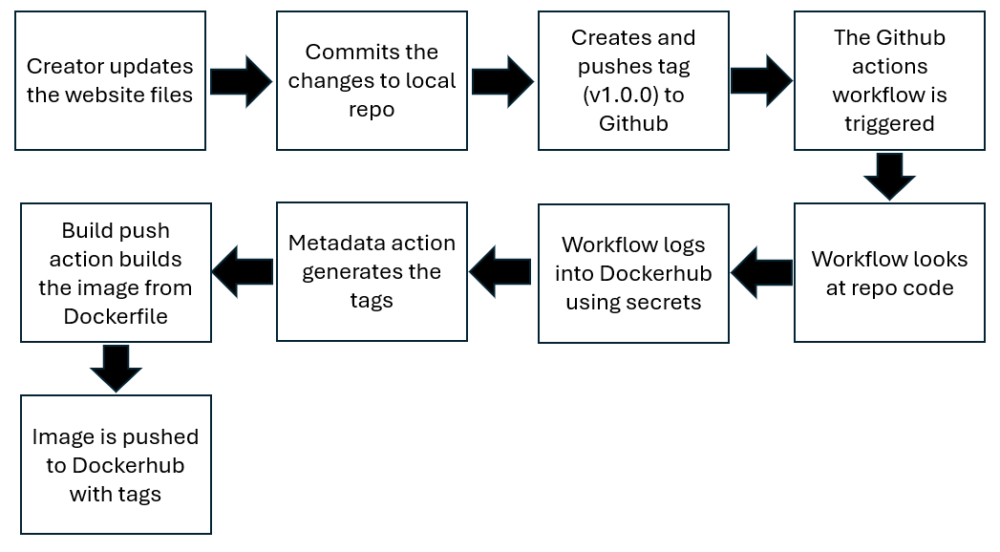

I reused the website files from my html class.
- index.html
- product.html
- products.html
- checkout.html
- cart.html
- stlye.css
  
Link to Dockerfile
- [Dockerfile](./Dockerfile)
- The Dockerfile uses httpd:2.4 base image. It copies web-content directory into Apache’s directory, allowing the server to give the website files.

docker build -t jackthompson/ceg3120-cicd:latest .   - docker build command 
docker run -d -p 8080:80 jackthompson/ceg3120-cicd:latest -run container

## Configuring GitHub Repository Secrets:
Go to docker website account settings and navigate to the personal access tokens.  
You can create a PAT for authentication here. Using read and write perms. 
  
In github repo settings you can go to settings-secrets and variables-actions-new repository secret to create the secrets.
  
${{ secrets.DOCKER_USERNAME }} is the format to call apon it.

## CI with GitHub Actions
The workflow runs automatically whenever I push a commit to the main branch.

GitHub actions looks at my repository, sets up Docker Buildx, logs into DockerHub, and builds and pushes my Docker image.

The DockerHub image name, repository secrets, and branch name may need to be changed.

I created .github/workflows/docker-build.yml to automatically build and push my Docker image.

I added the GitHub Actions workflow and configured the DOCKER_USERNAME and DOCKER_TOKEN repository secrets.

## Testing & Validating

I pushed a commit to main and verified that GitHub Actions completed successfully, then pushed to another branch to confirm it did not trigger.

I then pulled the latest image from DockerHub, and ran it in a container, and checked that my website loaded correctly.

[Link to my DockerHub repository](https://hub.docker.com/repository/docker/jackthompson/ceg3120-cicd/general)

## Generating tags

git tag    -lists tags in repo  
git show v1.0.0    -inspect tags  
git tag -a v1.0.0 -m "message"   -generate tag  
git push origin v1.0.0    -push tag  
  
## Semantic Versioning Container Images with GitHub Actions

The workflow runs only when I push a Git version tag such as v1.0.0 or v1.1.0.

GitHub Actions looks at repository, sets up Docker Buildx, creates version tags using docker-action, logs into Dockerhub, and builds and pushes the images.

I changed the trigger from pushes to main, to version tag pushes and added image tags.

I updated the website, changed the workflow file, and made the Git tags v1.0.0 and v1.1.0.

[Link to my workflow file](https://github.com/WSU-kduncan/ceg3120-cicd-Thompson741-f26/blob/48e75f4cfec94642aeda21aebe003be97e02e891/.github/workflows/docker-build.yml)

## Testing & Validating

I pushed both version tags and confirmed the workflows worked, then saw that an normal commit did not make a build.

I pulled versions 1.0 and 1.1, ran them on ports 8080 and 8081, and confirmed both website versions worked.

# Proof

## Local run - docker ps showing my container running, and a browser showing both of my pages with my CSS applied.
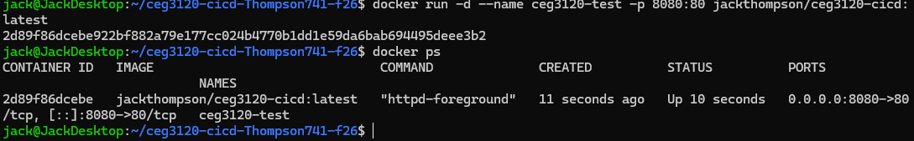

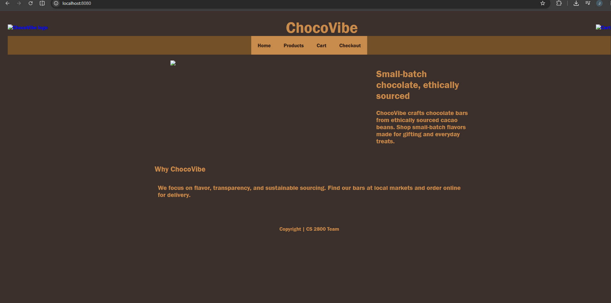

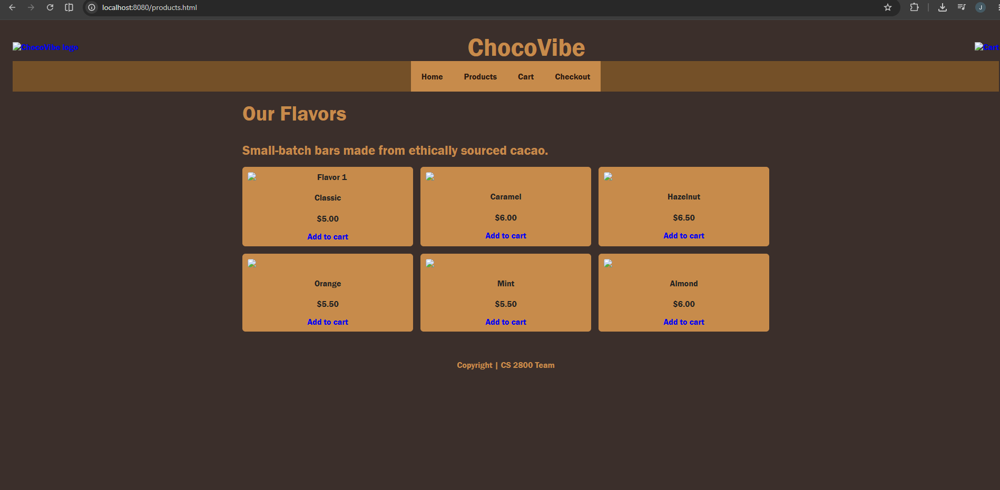
## Repository secrets - My repository's Actions secrets page showing DOCKER_USERNAME and DOCKER_TOKEN.
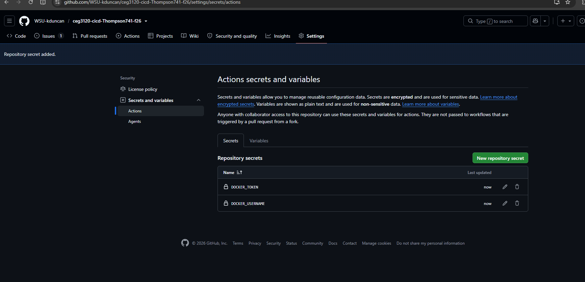
## Main trigger - a successful workflow run from a push to main
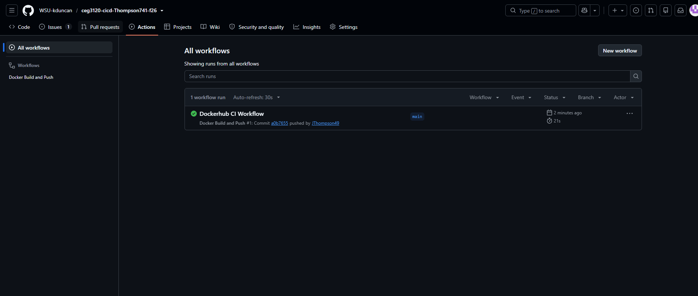
## Branch negative test - push a commit to a branch other than main, and the commit on that branch and that no workflow run started.
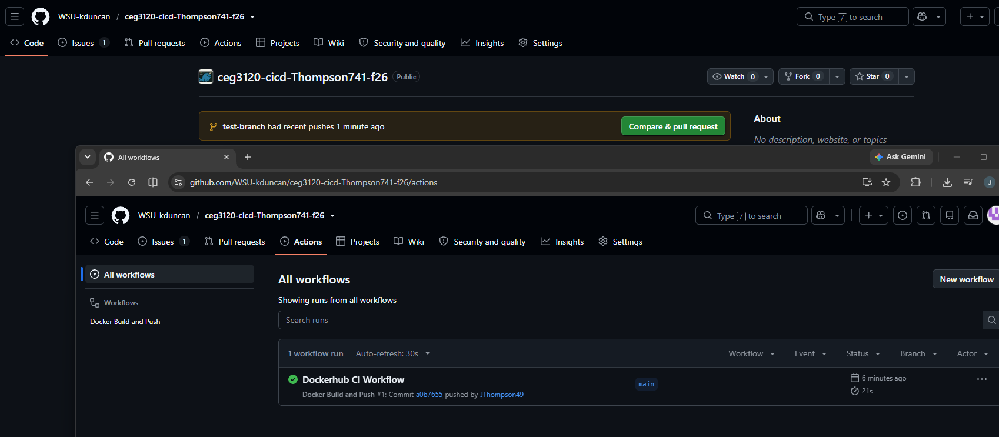
## Change to image - change visible text on my site and pushed it to main. After the workflow succeeded, pulled and ran the new image and the change in a browser.
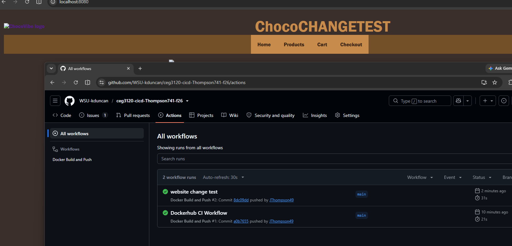
## Tag negative test - a commit without a tag, and the commit and that no workflow run started
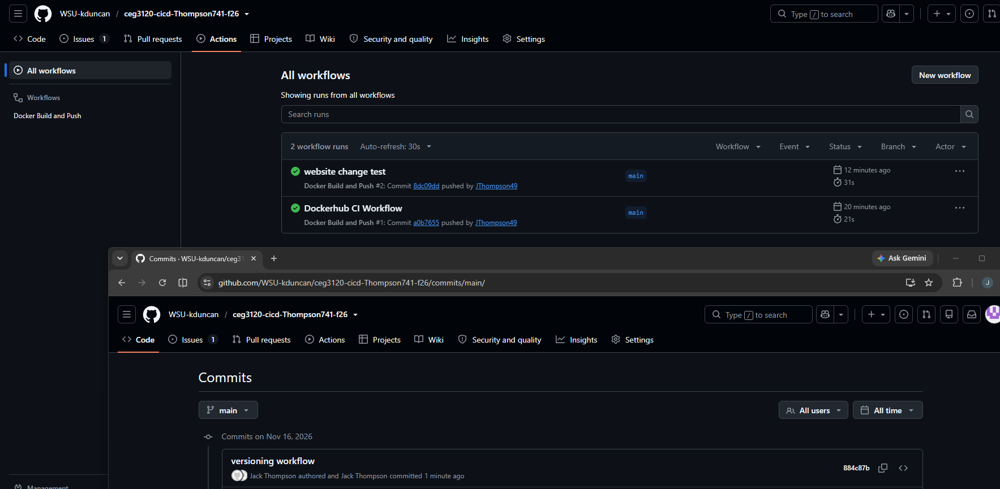
## Tag trigger - git tag -l output, and a successful workflow run with a tag as its event.
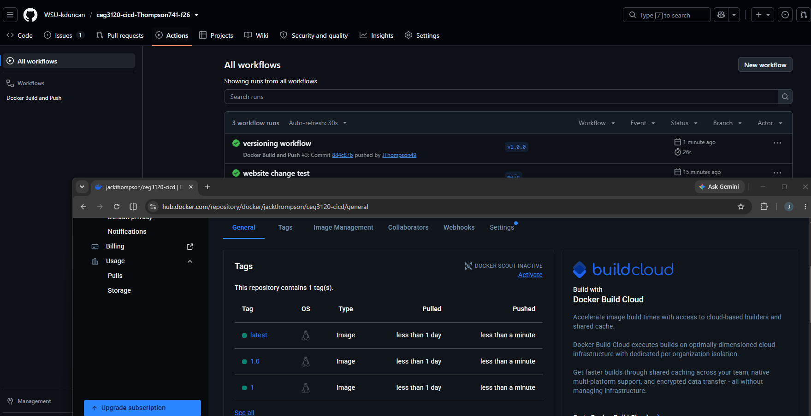
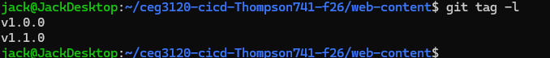
## Two releases - after my second release, my DockerHub tags and digests showing that 1 and latest moved to the new image while 1.0 stayed on the old image.
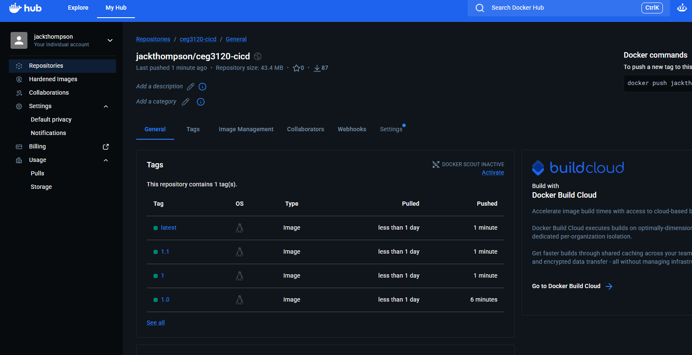
## Rollback - run containers from my major.minor tags and in a browser that each serves its version of the site.
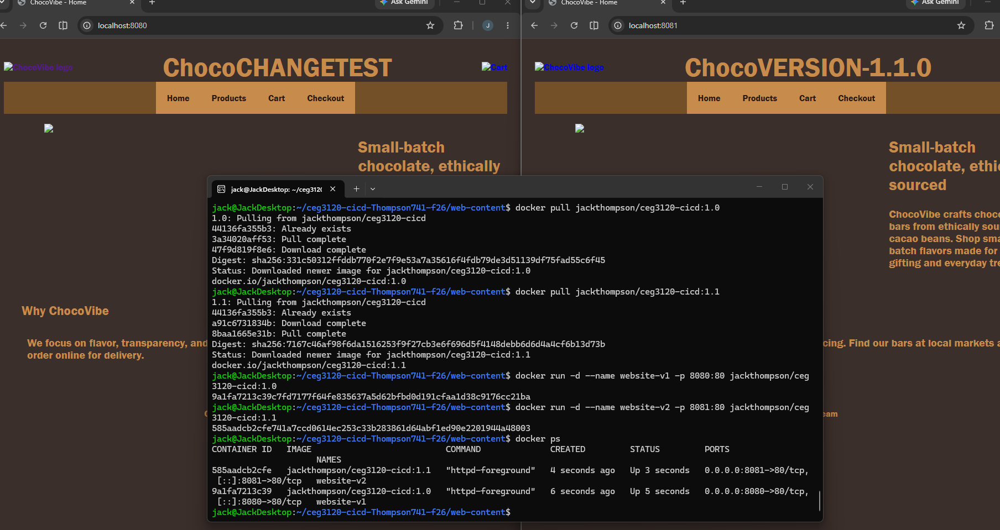
